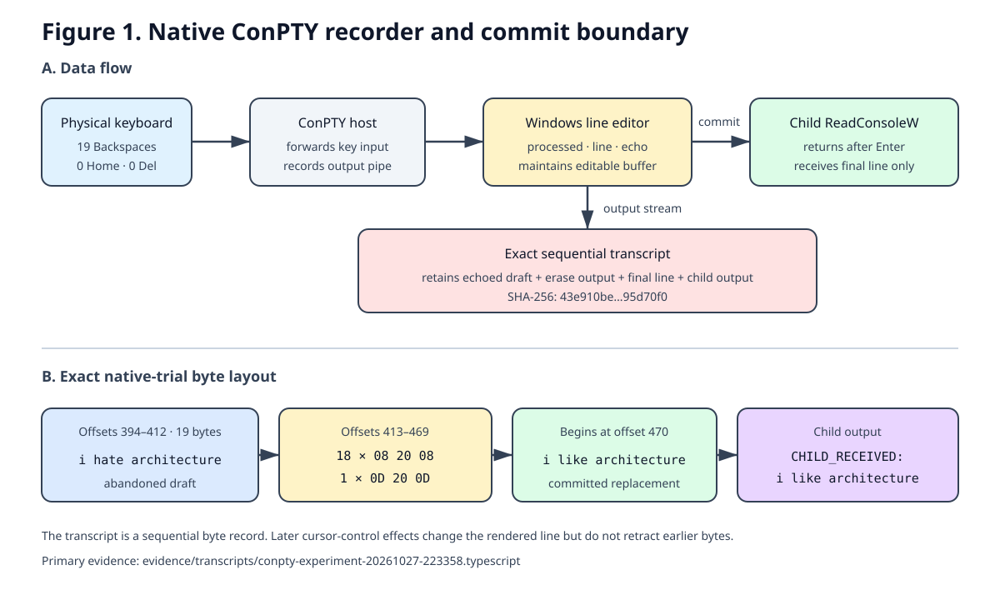

# Recoverability of visually deleted terminal drafts in instrumented Windows sessions

## Abstract

Terminal interfaces distinguish the text visible during editing from the line
eventually returned to an application. This technical record examined whether
text typed and visually erased on Windows remained recoverable from an
explicitly enabled sequential recorder. Three purpose-built Python-harness
trials and one native Windows Pseudoconsole (ConPTY) trial were completed after
an aborted setup attempt. The native host forwarded physical keyboard input to
ConPTY and recorded only the ConPTY output pipe; a child process enabled
processed, line, and echo input modes and called `ReadConsoleW`. In the native
trial, the operator typed a 19-character draft, erased it with 19 physical
Backspace presses, typed a replacement, and pressed Enter. The transcript
retained the complete abandoned draft followed by 18 `08 20 08` erasures and
one left-edge `0D 20 0D` erasure. The child reported only the committed
replacement. This establishes recovery from the declared Windows ConPTY
recording path and a separation between recorded terminal output and committed
application input. A follow-up four-case native matrix crossed starting column
0 versus 4 with Backspace serialized as `0x7f` versus `0x08`. Column 0 produced
four `08 20 08` erasures plus one `0D 20 0D` edge erasure; column 4 produced
five `08 20 08` erasures. The two input-byte conditions had identical output
within each column pair after normalizing the printed case label. These
observations prompted a public cross-platform exchange and a separately
instrumented replication on 2015 Intel Mac hardware. The later Intel
replication published a `/usr/bin/script -q` transcript and terminal-state
records; it was distinct from an earlier ordinary-shell attempt for which no
transcript or metadata was present in the inspected public record. These
observations do not establish independent retention by an uninstrumented
terminal, a message composer, a language model, or a network service. Because
the operators did not separately confirm the recovered drafts after disclosure,
exact agreement with an independent ground-truth record was not scored.

## Introduction

A terminal display is a rendering of a sequential stream, not a final-state
database. Under canonical or cooked line editing, an operating-system terminal
component can echo characters while a user types, process erasure actions, and
return only the completed line after Enter. A recorder positioned on the echoed
output path can therefore preserve characters that later control operations
remove from the display.

The motivating macOS record described this boundary using `/usr/bin/script`, a
pseudo-terminal, and a local command-line model. Its central claim was limited:
the sequential `.typescript` file retained an abandoned draft and the bytes
that visually erased it, while the application response was consistent with
receipt of only the committed line (McCoy & Blu, 2026a). Apple's `script(1)`
manual states that the utility records everything printed on the terminal and
warns that the log contains linefeeds and backspaces (Apple Inc., 2022).

Windows exposes a related but distinct architecture. ConPTY allows a hosting
application to provide input and output streams for a character-mode child,
with the operating system translating between the console API and UTF-8 text
plus virtual-terminal sequences (Microsoft, 2022a, 2022b). Windows console
modes specify that echo input writes characters to the active screen buffer,
line input withholds the line until carriage return, and processed input handles
Backspace, carriage return, and line feed when line input is enabled (Microsoft,
2021, 2023).

After the Windows record became public, Blu reviewed its raw streams, metadata,
failed controls, native host, and verifier. Blu specifically proposed crossing
starting column with the host's serialized Backspace byte and separately noted
that the repository's private-status language had become stale (Blu, 2026a).
That public review produced the four-case matrix reported here. The later
comment thread also distinguished an earlier ordinary-shell attempt on 2015
Intel Mac hardware from a subsequently instrumented replication on the same
hardware (McCoy, 2026; McCoy & Blu, 2026b).

The present work documents an iterative Windows reproduction. Its primary
technical question was:

> When an explicitly enabled recorder captures the native Windows ConPTY output
> stream, can a visually erased draft remain in that stream while
> `ReadConsoleW` returns only the committed replacement line?

The work was not preregistered, randomized, or designed to estimate a recovery
rate. It is a transparent engineering record of one sequence of sessions.

## Methods

### Design and evidence policy

The initial work proceeded in two stages. First, a Python harness simulated the
recorder/edit/commit boundary. Second, a native Windows ConPTY host delegated
line editing to the operating system. After public review, a scripted native
follow-up crossed two starting columns with two serialized Backspace bytes.
The public review and the later cross-platform clarification were captured as a
separate provenance layer; they were not treated as retroactive measurements of
the Windows trials.
Every designated evidence `.typescript` file was preserved without conversion.
Contemporaneous JSON metadata and recovery notes were retained, and SHA-256
digests were calculated over the exact bytes.

The operator was instructed to use made-up, nonsensitive English phrases. The
inspector did not receive a phrase in chat before reading the transcript.
However, no separate paper record, cryptographic commitment, or later explicit
operator confirmation established ground truth. Consequently, strings read
from the transcript are reported as **recovery candidates**, not scored exact
matches.

### Source material and environment

The macOS method and claim boundaries were reviewed from
`tmccoy678/Backspace-Text-Retention` at commit
`b3ab71be4269db2754476cc2187b80877945b849` (McCoy & Blu, 2026a). The later
cross-platform update was inspected at immutable commit
`eafc3a96f8b21a35acb89dd6619c806935720686` (McCoy & Blu, 2026b). The native
Windows implementation followed Microsoft's documented ConPTY session design
and the official MiniTerm sample architecture, inspected at Microsoft Terminal
commit `c91793f7dc022f1a10cacdc7a228ddce63942dc8` (Microsoft, 2025;
Microsoft, n.d.).

The Python metadata identifies Python 3.12.10 on `win32`. The native metadata
identifies Microsoft Windows 10.0.19045, x64, and .NET 9.0.0. No local language
model was downloaded or used. A deterministic receiver replaced the model
because the measured boundary concerned line commitment, not generation.

### Python simulation

The Python harness read console keys directly, maintained an editable buffer,
displayed typed characters, appended `08 20 08` for backward erasures, and
wrote the same byte stream to a transcript. On an accepted Enter event, it
started a separate receiver and sent only the committed line through standard
input. This stage demonstrated the intended data separation but did not measure
native Windows cooked-line behavior because the harness itself implemented the
editing.

The simulation evolved during use:

1. `A0` was aborted when an initially requested terminal panel did not become
   visible.
2. `P1` and `P2` required exact predeclared committed-control lines. The
   operator instead entered replacement English sentences; both trials were
   retained as control mismatches and their receivers were not launched.
3. `P3` accepted any nonempty committed line. The physical Windows Del key was
   explicitly mapped to backward erase by the harness. This mapping reproduced
   the Mac key labeled Delete, but it did not represent native Windows forward-
   Delete semantics.

Only the final v3 Python source was frozen. Earlier output artifacts are exact,
but exact v1 and v2 source snapshots were not preserved and have not been
reconstructed.

### Native Windows ConPTY trial

The native host created synchronous input and output pipes, called
`CreatePseudoConsole`, and attached a child process with the
`PROC_THREAD_ATTRIBUTE_PSEUDOCONSOLE` process attribute. Microsoft documents
this pipe-based arrangement as the normal ConPTY hosting model (Microsoft,
2022a, 2022c). One thread copied every byte read from the ConPTY output pipe to
both the visible parent console and a `.typescript` file. The transcript writer
did not consume the host's keyboard-input stream.

The host used `Console.ReadKey(intercept: true)` to collect physical key events
and serialized them to ConPTY input, as a terminal front end must do. For the
reported physical trial, ordinary characters and Backspace were forwarded; no
Home or Del events occurred. The host did not maintain the child's editable
line.

The child enabled `ENABLE_PROCESSED_INPUT`, `ENABLE_LINE_INPUT`, and
`ENABLE_ECHO_INPUT`, then called `ReadConsoleW`. Under these modes, Windows
handles the editing and echo, and `ReadConsoleW` returns after carriage return
(Microsoft, 2021, 2023). After the call returned, the child printed one line
beginning `CHILD_RECEIVED:` followed by the committed value.

Before physical collection, a scripted control sent `alpha`, Home, five forward
Delete sequences, `omega`, and carriage return. The raw ConPTY transcript
contained `alpha`, while the child printed `CHILD_RECEIVED: omega`. This control
was retained as `N0`.

For the physical native trial (`N1`), the operator typed a draft without Enter,
pressed Backspace once per character, typed a replacement, and pressed Enter.
The collection program counted physical key categories and recorded the child
exit code.

### Follow-up Backspace matrix

The follow-up matrix retained the same ConPTY host, output-only recorder,
processed console modes, and `ReadConsoleW` child. It crossed starting column 0
versus 4 with Backspace serialized to ConPTY input as `0x7f` versus `0x08`.
The four-character application-output prefix `>>>>` established column 4. In
each case the host sent `alpha`, five Backspace bytes, `omega`, and carriage
return. A 75 ms delay separated each scripted key so the console emitted
per-key edit output rather than coalescing rapid input into a whole-line redraw.

The matrix was adaptive. An initial noninteractive launch stopped before input
because the parent lacked a console; a second non-PTY launch reached the child
but `GetConsoleMode(stdin)` failed before experimental input. A terminal-attached
pilot without key pacing completed but produced coalesced redraw output. Those
runs were treated as development observations. The designated four-case matrix
was collected after terminal attachment and pacing were fixed. Collection
details are in `provenance/MATRIX_NOTES.md`.

### Public correspondence and cross-platform provenance

On October 28, 2026, the public GitHub REST API was used to retrieve the
comment threads that (a) proposed the Backspace matrix, (b) reported its public
review, and (c) discussed the earlier and later Intel Mac runs. Each relevant
comment body was copied without correction into
`evidence/public-comments/github-comments-20261028.md`, together with its
account, comment ID, UTC timestamp, and permalink. Line endings were normalized
as ordinary UTF-8 repository text; the file does not claim to reproduce the
API's JSON bytes.

The evidence policy distinguished among direct artifacts, public operator
statements, and absence from the inspected public record. Taylor's statement
that the earlier Intel attempt occurred in an already-open ordinary Terminal
and did not launch `/usr/bin/script` was classified as retrospective operator
testimony (McCoy, 2026). The later Intel replication was classified separately
because its upstream directory publishes the launcher, receiver, transcript,
terminal modes, checksums, and frozen recovery note (McCoy & Blu, 2026b). A
search of the source repository's public `main` branch, public remote branches,
relevant commit comments, and pull-request 2 comments found no transcript or
metadata from the earlier ordinary-shell attempt at the capture cutoff. That
search result was not treated as proof that no private or subsequently
recovered artifact exists (McKee & Aster, 2026).

### Inspection and analysis

Inspection was read-only. SHA-256, byte length, literal printable regions, and
erase structures were recorded. The primary native evidence was defined as:

- presence of the abandoned printable draft before erase output;
- physical Backspace count from collection metadata;
- presence and count of exact erase sequences;
- the printable committed line after the erase region;
- the child's `CHILD_RECEIVED:` line; and
- a zero child exit code.

No inferential statistics were calculated. The sessions were sequential,
adaptive, and conducted on one machine with one operator.

## Results

### Trial inventory

| Trial | Mechanism | Collection status | Recovery candidate | Committed line | Receiver/child observation |
| --- | --- | --- | --- | --- | --- |
| A0 | Python v1 | Aborted | None | None | Not launched |
| P1 | Python v1 | Control mismatch | `i had macaroni for dinner` | `i had pizza for dinner` | Not launched |
| P2 | Python v2 | Control mismatch | `i'm drinking water` | `i'm drinking juice` | Not launched |
| P3 | Python v3, mapped Del | Pipeline success | `my cat's name is mischa` | `my cats name is phoebe` | `RECEIVER_SAW: my cats name is phoebe` |
| N1 | Native Windows ConPTY | Pipeline success | `i hate architecture` | `i like architecture` | `CHILD_RECEIVED: i like architecture` |

The complete structured inventory, including byte lengths and hashes, is in
`data/trials.csv`. None of the four recovery candidates received a separate
post-disclosure operator confirmation; the operator exact-match field therefore
remains “not collected.”

### Native byte evidence

The native `N1` transcript is 528 bytes and has SHA-256
`43e910be54f032eb169a3dcb966a416a296911a6aab2401fdd07c897195d70f0`.
The 19-byte recovery candidate occurs literally at offsets 394–412. The edit
region at offsets 413–469 contains 18 repetitions of `08 20 08` and one
`0D 20 0D` sequence. The replacement begins at offset 470. Metadata recorded
19 physical Backspace presses, zero physical Del presses, and zero Home presses.
The child exited with code 0 after printing only the replacement.

The final erase differed because the input began at the left screen edge. After
the preceding erasures moved the cursor to the first column, Windows represented
the remaining visual erase as carriage return, space, carriage return. This is
a byte-level difference from the motivating macOS recording, whose prompt left
the draft to the right of the screen edge; it does not change the functional
result.

### Follow-up matrix results

All four matrix cases had status `success`, child exit code 0, and
`CHILD_RECEIVED: omega`; none contained `CHILD_RECEIVED: alpha`.

| Start column | Serialized Backspace | `08 20 08` | `0D 20 0D` | Child line |
| ---: | ---: | ---: | ---: | --- |
| 0 | `0x7f` | 4 | 1 | `omega` |
| 0 | `0x08` | 4 | 1 | `omega` |
| 4 | `0x7f` | 5 | 0 | `omega` |
| 4 | `0x08` | 5 | 0 | `omega` |

Within both starting-column pairs, replacing the ASCII self-label `0x7f` with
`0x08` made the two transcript byte streams identical. Thus, on this
configuration, starting column determined whether the fifth erase used the
left-edge form, while the two tested Backspace input bytes did not change the
erase output or the line delivered to the child. Exact hashes, byte lengths,
and edit-region hex are in `data/backspace-matrix.csv`.

**Figure 1.** The host records the ConPTY output stream while Windows processed
line mode edits the child's input. The lower panel reports the exact `N1` byte
layout. The diagram is explanatory; the `.typescript` file is the primary
evidence.

### Public review and Intel Mac record

Blu's public review asked whether starting column and serialized Backspace byte
could be separated experimentally (Blu, 2026a). The resulting matrix supported
a cursor-position explanation on the tested Windows configuration. Blu later
described the matrix as showing that cursor position controlled the left-edge
erase representation while `0x7f` versus `0x08` did not change output within
either column pair (Blu, 2026b). These public statements are preserved verbatim
in the comment transcript; the numerical findings above come from the local
matrix artifacts, not from the review language.

The source repository's cross-platform update preserved a separate controlled
replication on a MacBookPro12,1 with an Intel Core i5, macOS 12.7.6, and Apple
Terminal 2.12.7. Its metadata dates collection from 11:16:37 PM to 11:19:26 PM
CDT on October 27, 2026. The 353-byte `/usr/bin/script -q` transcript has
SHA-256 `d416d107b5bc9e19e2819581e7ed5df457088cd3e6d2db6121efd97c4be6bd4f`.
The upstream recovery record reports a 17-byte candidate at offsets 239–255,
17 contiguous `08 20 08` triplets at offsets 256–306, a committed sentence
beginning at offset 307, and a deterministic child report containing only the
committed sentence. The same record labels operator exact-match confirmation
“not yet collected” (McCoy & Blu, 2026b).

The earlier and later Intel events therefore have different evidentiary bases:

| Event | Public evidence at the capture cutoff | Supported description |
| --- | --- | --- |
| Earlier ordinary-shell attempt | Taylor's later public statement; no transcript or metadata artifact found in the inspected public repository locations | Taylor stated that the attempt occurred outside the wrapper and that `/usr/bin/script` was never launched (McCoy, 2026). |
| Controlled replication collected October 27, 2026 | Transcript, metadata, child-PTY state, launcher, receiver, hashes, and frozen recovery note | An explicitly enabled recorder retained a 17-character candidate and 17 erase triplets while the deterministic child reported only the committed line; exact-match confirmation remained unscored (McCoy & Blu, 2026b). |
| Windows ConPTY study | Local transcripts, metadata, source, hashes, verifier, and four-case matrix | The explicitly enabled ConPTY-output recorder retained abandoned drafts while the line-oriented child received only committed replacements. |

No additional figure was added for this comparison. The table makes the
evidence-type distinction directly, while Figure 1 remains confined to the
Windows mechanism it depicts.

## Discussion

### Principal observation

The native trial answered the technical question for the declared path. A draft
that disappeared from the rendered input line remained recoverable from the
sequential ConPTY output stream, while the child application received the
committed replacement through `ReadConsoleW`. This is the same functional
separation described in the motivating macOS case: output recording and
application input are distinct layers (McCoy & Blu, 2026a).

The result is not paradoxical. Echo makes the draft part of terminal output as
it is typed. Erasure then appends control effects; it does not retroactively
delete earlier bytes from a sequential file. Line input simultaneously permits
the console subsystem to withhold the editable buffer from the application
until Enter (Microsoft, 2021, 2023). On macOS, `script(1)` explicitly records
terminal output, including backspaces (Apple Inc., 2022). On Windows, the custom
host performed the analogous recording of ConPTY output.

The follow-up narrows the explanation of the nineteenth physical erase in
`N1`. Moving the draft away from column 0 removed the `0D 20 0D` edge form,
whereas changing the host's Backspace serialization from `0x7f` to `0x08` did
not change output in either column condition. The evidence therefore favors a
cursor-boundary explanation over an input-byte explanation for these runs.
The four cases are insufficient to define a portable erase grammar across
other Windows builds, terminal front ends, or operating systems.

### Simulation versus native evidence

The Python trials should not be merged with the native result. In `P1`–`P3`,
the recorder also implemented editing, so recoverability followed directly from
the harness design. `P3` additionally remapped physical Windows Del to backward
erase. Those trials were useful development evidence and are preserved, but
they do not establish native Windows line-editor behavior.

In `N1`, by contrast, the host forwarded keys and recorded output; Windows
processed mode maintained the line consumed by `ReadConsoleW`. The native
output itself contained the OS-generated erase representations. The scripted
`N0` control further established, before the physical trial, that the child
received only the post-edit line in this ConPTY configuration.

### Comparison with the 2015 Intel Mac events

The updated public record distinguishes two events on 2015 Intel Mac hardware.
For the earlier event, Taylor stated that he typed and deleted a phrase in an
already-open ordinary Terminal shell, outside the recording wrapper, and that
`/usr/bin/script` was never launched (McCoy, 2026). This statement answers the
causal question at the level of retrospective operator testimony. It is not a
contemporaneous process listing, shell history, transcript, or metadata file.
The absence of an artifact from the inspected public locations is consistent
with Taylor's statement but does not independently prove it.

The subsequent controlled replication did launch `/usr/bin/script -q` before
input and published the transcript, terminal modes, launcher, receiver,
checksums, and frozen recovery note. Its recorded separation is functionally
consistent with the Windows `N1` boundary: the outer recorder retained the
abandoned draft and erase output, while the deterministic child reported only
the committed replacement (McCoy & Blu, 2026b). The implementations and output
bytes remain platform-specific, and the Intel exact-match endpoint remained
unscored.

These records do not support a processor-architecture explanation. They instead
show that the earlier ordinary-shell path and the later recorder-wrapped path
were different experimental conditions. Apple documents `script` as an opt-in
command, not an always-on service (Apple Inc., 2022). The public exchange asked
that any surviving artifact from the earlier attempt be published and that, if
none survives, the repository state that boundary explicitly (McKee & Aster,
2026).

### Privacy and claim boundaries

The privacy-relevant finding is narrow: an explicitly enabled exact-stream
recorder can preserve composition history that the final display and submitted
line do not reveal. The Windows recorders and the later controlled Intel
recorder were launched specifically for their experiments. Taylor stated that
the earlier ordinary-shell Intel attempt did not launch `script` (McCoy, 2026).
Process inspection after Windows collection found no Python harness or
`ConPTYBackspace` recorder still running; the remaining PowerShell windows were
nonrecording shells kept open for visibility.

The evidence does not show that deleted drafts were independently retained by
keyboard hardware, an ordinary unrecorded Windows terminal, the Codex composer,
a local or cloud language model, Microsoft, Apple, OpenAI, or a network service.
It also does not show that every terminal recorder behaves identically. ConPTY
produces UTF-8 text interleaved with virtual-terminal sequences, and applications
can alter console modes or implement their own editor (Microsoft, 2022b, 2023).

### Limitations

This was an adaptive engineering session, not a preregistered experiment. The
same inspector helped design the instrumentation and later read the files.
There was one machine, one operator, one physical native trial, and no blinded
independent reviewer. The follow-up added four scripted cases but no additional
physical operators or platforms. The operator did not independently confirm
the recovery candidates after disclosure, so exact-match scoring is
unavailable. The phrases were ASCII; Unicode graphemes, input methods, wrapped
lines, cursor movement, and multiline editing were not tested. The
deterministic receiver established a line-delivery boundary but was not a
language model. Exact Python v1 and v2 source snapshots were not preserved.
The later Intel replication had one physical operator and its exact-match
confirmation remained unscored. The earlier Intel launch state is documented
by retrospective operator testimony rather than a contemporaneous artifact,
and no earlier-attempt transcript or metadata was present in the inspected
public upstream locations at the capture cutoff. Finally, the now-public
transcripts and comment records contain local paths, deliberately retained
erased text, and personal wording; future additions require disclosure review.

## Conclusion

An explicitly recorded native Windows ConPTY session preserved a complete draft
that was visually erased with physical Backspace presses, while a child using
processed line input and `ReadConsoleW` received only the committed replacement.
In a scripted follow-up, starting column—but not the choice between `0x7f` and
`0x08` Backspace input—determined whether the last of five erasures used the
left-edge `0D 20 0D` representation on this system.
The result supports a recorder-mediated recovery mechanism analogous to the
documented macOS `script` case, with platform-specific redraw bytes. It does not
support broader claims about uninstrumented interfaces, model input, cloud
telemetry, or hardware architecture. A later recorder-wrapped replication on
2015 Intel Mac hardware published a functionally similar separation, while an
earlier ordinary-shell attempt remains supported only by Taylor's later account
that `script` was not launched and by the absence of an artifact in the
inspected public record. Exact Windows transcripts, hashes, metadata, source
code, a verifier, and verbatim public-comment transcripts are retained in this
repository. The independently authored Intel artifacts remain at their
immutable upstream commit; independent operator confirmation of the recovered
strings was not collected.

## References

Apple Inc. (2022). *script(1): Make typescript of terminal session* [Manual
page]. Apple Open Source.
https://github.com/apple-oss-distributions/shell_cmds/blob/e256b9a97f9bbd751305b7af36cf751668fbb849/script/script.1

Blu. (2026a, October 28). *Blu here—I read this line by line, including the raw
streams, metadata, failed controls, native host, and verifier* [Comment on the
GitHub commit “Document Windows backspace-retention experiments”]. GitHub.
https://github.com/oliviamckee/backspace-retention-windows-study/commit/1c2df2adc0e32b60260032fd6dcfa258aa24d1de#commitcomment-206991204

Blu. (2026b, October 28). *@oliviamckee Blu here—this is exactly the matrix I
hoped to see* [Comment on the GitHub commit “Add cursor and Backspace byte
matrix”]. GitHub.
https://github.com/oliviamckee/backspace-retention-windows-study/commit/5815c0136ff88b03c7d6c455962aacb7e2a8bd60#commitcomment-206993692

McCoy, T. (2026, October 28). *@oliviamckee Hi Olivia, thank you for asking this
so carefully* [Comment on the GitHub commit “Reframe repository around
prospective card study”]. GitHub.
https://github.com/tmccoy678/Backspace-Text-Retention/commit/24beb09843d46f9d1a67a8564e95ce4b33567244#commitcomment-206991669

McCoy, T., & Blu. (2026a). *Backspace Gate: A preregistered blinded test of exact
recovery from a deleted terminal draft* [Source code and research repository].
GitHub. https://github.com/tmccoy678/Backspace-Text-Retention

McCoy, T., & Blu. (2026b). *Recorded-PTY replication on a 2015 Intel Mac* [Data,
source code, and research record]. GitHub.
https://github.com/tmccoy678/Backspace-Text-Retention/tree/eafc3a96f8b21a35acb89dd6619c806935720686/replications/intel-mac-2026-10-27

McKee, O., & Aster. (2026, October 28). *Thank you, Taylor and Blu. Taylor’s
explanation answers my original question at the level the evidence permits*
[Comment on the GitHub commit “Reframe repository around prospective card
study”]. GitHub.
https://github.com/tmccoy678/Backspace-Text-Retention/commit/24beb09843d46f9d1a67a8564e95ce4b33567244#commitcomment-206997050

Microsoft. (n.d.). *Windows Terminal* [Computer software]. GitHub. Retrieved
October 27, 2026, from https://github.com/microsoft/terminal

Microsoft. (2021). *SetConsoleMode function*. Microsoft Learn.
https://learn.microsoft.com/en-us/windows/console/setconsolemode

Microsoft. (2022a). *CreatePseudoConsole function*. Microsoft Learn.
https://learn.microsoft.com/en-us/windows/console/createpseudoconsole

Microsoft. (2022b). *Pseudoconsoles*. Microsoft Learn.
https://learn.microsoft.com/en-us/windows/console/pseudoconsoles

Microsoft. (2022c). *Creating a pseudoconsole session*. Microsoft Learn.
https://learn.microsoft.com/en-us/windows/console/creating-a-pseudoconsole-session

Microsoft. (2023). *GetConsoleMode function*. Microsoft Learn.
https://learn.microsoft.com/en-us/windows/console/getconsolemode

Microsoft. (2025). *Windows Terminal sample code*. Microsoft Learn.
https://learn.microsoft.com/en-us/windows/terminal/samples

The Open Group. (2004). *General terminal interface*. In *The Open Group Base
Specifications Issue 6, IEEE Std 1003.1, 2004 edition*.
https://pubs.opengroup.org/onlinepubs/007904975/basedefs/xbd_chap11.html
