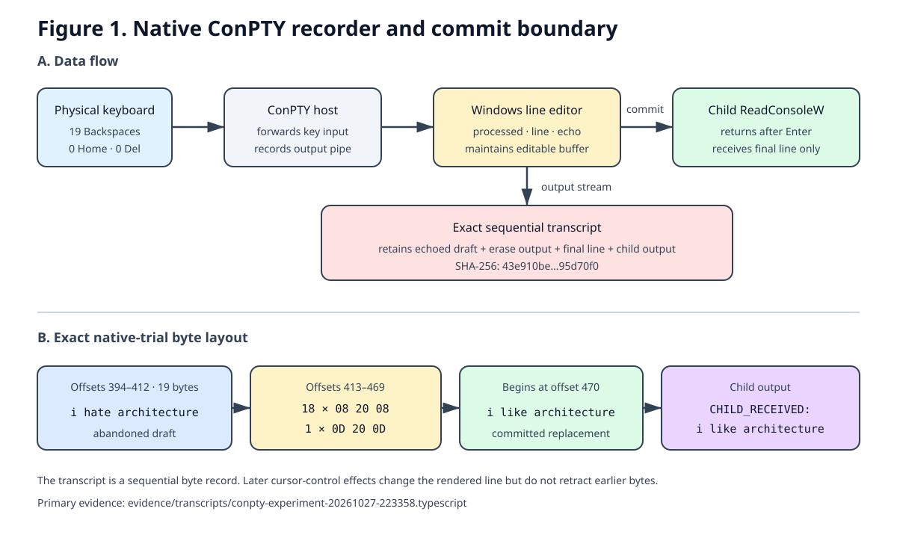

# Backspace retention on Windows: simulation and native ConPTY evidence

This public repository preserves a sequence of Windows experiments prompted by
the methods in McCoy and Blu's *Backspace Text Retention* repository. It contains
the exact locally generated terminal transcripts, their contemporaneous
metadata, the code used for the final simulation and native Windows trials, a
reproducible verifier, and a manuscript that separates observations from
interpretation.

> **Privacy notice:** this repository is public. The raw transcripts
> intentionally contain text that was typed and then visually deleted, as well
> as local paths. Review those fields before reusing the evidence or adding new
> transcripts.

## Evidence status

- The first launch was aborted before an experimental phrase was entered.
- Two Python-harness trials preserved erased drafts but failed their predeclared
  committed-control checks, so no receiver was launched.
- A third Python-harness trial completed the receiver boundary, but its physical
  Windows Del key was deliberately mapped to backward erase by the harness.
- The October 27 native trial used Windows ConPTY line editing with physical
  Backspace input. The raw ConPTY stream retained the abandoned draft, while
  `ReadConsoleW` returned only the committed replacement line.
- A four-case scripted native follow-up crossed starting column 0 versus 4 with
  Backspace serialized as `0x7f` versus `0x08`. Starting column changed the
  final erase representation; the serialized byte did not change the output
  within either column pair.
- A November 2 matched native follow-up used the physical Windows Delete key
  with forward-delete semantics after Left Arrow navigation. Nine physical
  Delete presses removed `bubblegum`; the output recorder retained the complete
  draft and repeated shrinking-line redraws, while `ReadConsoleW` returned only
  `cherries`. The recovery was frozen before Olivia confirmed an exact match.
- An October 28 ordinary PowerShell follow-up was not connected to a sequential
  recorder available to Aster during input. Olivia later supplied a plain-text
  screen copy and reported that Taylor had expected recovery of a phrase typed
  and erased before `phoebe is sleeping`. The copy contains the submitted
  `phoebe is sleeping` entry but no erased draft, Backspace byte, Delete byte,
  or terminal escape byte. No phrase could be recovered from that artifact.
- Taylor and Blu's October 28 retrospective audit states that the known
  content-complete positive used an external `/usr/bin/script` recorder, that
  ordinary graphical Codex persists its latest current draft, and that no
  surviving artifact establishes durable retention of a fully erased earlier
  revision by an ordinary Codex app or CLI. They state that no new retention
  experiment was run for that answer.
- A November 2 shared extended abstract likewise describes recorder-mediated,
  later tool access rather than passive receipt by an ordinary Codex composer.
  Taylor subsequently published the requested fresh ordinary Codex CLI
  observation. Its first no-tool answer supplied no recovery candidate for the
  erased phrase; no tool-assisted second endpoint was collected. A later live
  process inspection found no external content recorder in the Terminal to
  Codex ancestry. This is a bounded negative first-answer observation, not
  proof of universal non-retention.
- Taylor and Blu's later public audit separates three Intel episodes: an
  unrecorded September 21 Terminal attempt, an ordinary-shell October 27
  attempt with only a saved final-state output, and a controlled October 27
  `/usr/bin/script -q` replication. Only the controlled replication published
  a sequential transcript containing erase bytes.
- The original recovery strings remain byte-level candidates because no
  separate post-disclosure exact-match confirmation was collected. `N2`
  separately froze `bubblegum` before disclosure and then obtained Olivia's
  exact confirmation.

The full account, including limitations and APA references, is in
[MANUSCRIPT.md](MANUSCRIPT.md).



## Follow-up Backspace matrix

The follow-up used the same native ConPTY/`ReadConsoleW` boundary and paced each
scripted key by 75 ms. Every case echoed and erased `alpha`, committed `omega`,
and ended with `CHILD_RECEIVED: omega`.

| Start column | Input byte | `08 20 08` | `0D 20 0D` |
| ---: | ---: | ---: | ---: |
| 0 | `0x7f` | 4 | 1 |
| 0 | `0x08` | 4 | 1 |
| 4 | `0x7f` | 5 | 0 |
| 4 | `0x08` | 5 | 0 |

After normalizing only the printed case label, the `0x7f` and `0x08`
transcripts were byte-identical within each starting-column pair. This supports
the left-edge explanation for `N1` on this configuration; it does not establish
a universal cross-platform erase grammar. Exact results are in
[`data/backspace-matrix.csv`](data/backspace-matrix.csv), with collection notes
in [`provenance/MATRIX_NOTES.md`](provenance/MATRIX_NOTES.md).

## Physical Windows forward-Delete follow-up

The `N2` follow-up used the same native ConPTY/`ReadConsoleW` boundary as `N1`,
but it did not remap Delete to Backspace. Olivia typed a nine-character draft,
navigated to its beginning with Left Arrow, pressed the physical Windows Delete
key nine times, typed a replacement, and pressed Enter. Generated metadata
records nine Delete presses, zero Backspace presses, and zero Home presses.

| Layer | Directly preserved `N2` result |
| --- | --- |
| Recorder output | `bubblegum`, cursor-left output, nine forward-Delete redraws, then `cherries` |
| Child input | `CHILD_RECEIVED: cherries` |
| Frozen recovery | `bubblegum` |
| Post-disclosure confirmation | Olivia replied `yes exactly`; exact-match outcome = 1 |

The physical forward-Delete output differs from physical Backspace. `N1`
contained 18 exact `08 20 08` erase triplets and one `0D 20 0D` edge erase.
`N2` contained no `08 20 08` triplet; it repeatedly redrew the shortening line
after carriage returns (`ubblegum`, `bblegum`, `blegum`, and so forth). Both
abandoned drafts remained recoverable from the explicitly enabled sequential
recorder, while each child received only the submitted replacement.

The exact transcript, generated metadata, confirmation record, executable and
source hashes, byte offsets, restart boundary, and limitations are documented
in
[`evidence/analysis/physical-forward-delete-20261102.md`](evidence/analysis/physical-forward-delete-20261102.md).
No new figure was added because the byte rendering and short comparison table
show the key difference directly.

## Ordinary PowerShell screen-copy follow-up

This follow-up tested a different evidence path from the recorded ConPTY trial.
Aster could not see the open PowerShell window or its live input stream. After
the session, Olivia supplied
[`backspacetextretention2.txt`](evidence/screen-copies/backspacetextretention2.txt),
a 1,579-byte plain-text copy of the rendered PowerShell screen.

| Item | Directly preserved result |
| --- | --- |
| Olivia's operator report | Taylor gave real-time direction and expected recovery of a phrase Olivia typed and erased before `phoebe is sleeping`; Taylor was surprised when Aster did not recover it. |
| Visible submitted entry | `phoebe is sleeping`, followed by a PowerShell `CommandNotFoundException` for `phoebe` |
| Earlier erased phrase | Not present in the supplied file; no recovery candidate was produced |
| Editing bytes | Zero `0x08` Backspace, zero `0x7f` Delete, and zero `0x1b` escape bytes |
| Recorder marker | No PowerShell `Start-Transcript` header in the file |

The screen copy records the final rendered state, not the sequential editing
history. Its negative result therefore does not contradict the instrumented
ConPTY and `/usr/bin/script` trials: those paths created stream recorders before
input. The exact operator report, visible entries, byte counts, and claim
boundary are documented in
[`evidence/analysis/powershell-screen-copy-20261028.md`](evidence/analysis/powershell-screen-copy-20261028.md).
No new figure was added because this direct table is sufficient.

## Public review and Intel Mac context

The current public source distinguishes three Intel Mac events and one Windows
study. They are not interchangeable:

| Event | Recorder evidence | What the public record supports |
| --- | --- | --- |
| September 21 ordinary Terminal attempt on a 2015 Intel Mac | No native sequential transcript; later public audit includes contemporaneous conversation excerpts, a failed preflight, search coverage, and a redacted shell-history derivative | The proposed recorder was never launched. The surviving history contains one untimestamped committed-line candidate but no erased draft. |
| October 27 ordinary-shell attempt on the same 2015 Intel Mac | A 128-byte saved final-state output and later audit, but no sequential recorder artifact | The saved output preserves the committed replacement, not an erase trace. |
| Controlled replication on the same 2015 Intel Mac hardware, collected October 27, 2026 | Published `/usr/bin/script -q` transcript, terminal modes, launcher, receiver, hashes, and frozen recovery note | The recorder retained a 17-character candidate followed by 17 `08 20 08` erase triplets; the deterministic child reported only the committed line. Exact-match confirmation remained unscored. |
| This Windows ConPTY study | Exact local transcripts, metadata, source, hashes, and verifier in this repository | The explicitly enabled ConPTY-output recorder retained the abandoned draft while `ReadConsoleW` returned only the committed replacement. |

The Intel replication remains in its independently authored source repository
at immutable commit
[`eafc3a9`](https://github.com/tmccoy678/Backspace-Text-Retention/tree/eafc3a96f8b21a35acb89dd6619c806935720686/replications/intel-mac-2026-10-27).
The later public September audit and redacted history are preserved at upstream
commit
[`f4be7cb`](https://github.com/tmccoy678/Backspace-Text-Retention/tree/f4be7cbd8a4b1cf50e9dd503de0b7877e801d9aa/investigations/2026-09-21-pre-control-and-intel).
The exact public comments that prompted the matrix, clarified the ordinary-shell
attempt, and defined the remaining evidence boundary are preserved in
[`evidence/public-comments/github-comments-20261028.md`](evidence/public-comments/github-comments-20261028.md).
No new figure was added for this update because the table distinguishes the
three records directly; Figure 1 remains limited to the Windows mechanism and
byte evidence.

## November 2 submission and ordinary-Codex catch-up

Taylor shared a two-page extended abstract titled *Abandoned Terminal Drafts
Become Agent-Readable Telemetry*, naming Taylor Westfall-McCoy and Olivia McKee
as authors. The review found that its main claim is narrower than ordinary
Codex retention: terminal echo entered an output recorder, and a later
deliberate tool read exposed that artifact to an agent. The abstract says no
new experiment was conducted and does not claim that an ordinary Codex
composer or network service received the erased draft during typing.

The missing experiment was specified as a fresh, directly launched Codex
CLI session with no Blu Offline wrapper or external content recorder. Taylor
would type a harmless phrase without submitting it, erase it completely with
Backspace, submit an unrelated replacement, and only then ask the agent to
identify the erased phrase. The first answer would be frozen before tool use or
ground-truth disclosure. An optional second endpoint could allow read-only
inspection of ordinary Codex-created state, separating conversational access
from later tool-mediated access.

Taylor subsequently published a fresh Apple Terminal and ordinary Codex CLI
observation. Only `piggy is sleeping` was submitted. When asked for the exact
phrase erased immediately beforehand, the first answer supplied no recovery
candidate and stated that it received only the replacement. A live post-result
process inspection recorded `Terminal -> login -> zsh -> Codex CLI 0.166.0`
with no detected external recorder. The erased phrase remains unpublished, no
tool-assisted second endpoint was collected, and the observation does not
establish absence from volatile memory, application state, or provider
telemetry.

The exact request, controls, source identities, shared-PDF hash, submission
distinctions, and APA references are in
[`evidence/analysis/submission-catchup-20261102.md`](evidence/analysis/submission-catchup-20261102.md).
That note is retained as the version-one review.

A revised anonymous draft materially resolves the earlier concerns about
passive receipt, recorder durability versus later recognition, the browser
demonstration, and the authority of abandoned text. The version-two review
marks each earlier item as resolved, superseded, partly addressed, or still
open in
[`evidence/analysis/submission-review-v2-20261102.md`](evidence/analysis/submission-review-v2-20261102.md).
The revised PDF predates `N2`, so its statements that physical forward Delete
was unmeasured and that Windows candidates lacked exact confirmation are now
outdated: `N1` remains unconfirmed, while `N2` was frozen before exact-match
confirmation. Before submission, Taylor and Blu should also verify the exact
source commit and immutable contents exposed by anonymous reference [7].

The PDFs themselves are not redistributed. The withdrawn Sticky Notes
condition is not part of the requested test. The subsequent public source
update, recorder chronology, Intel chronology, and ordinary-Codex result are
reviewed in
[`evidence/analysis/upstream-evidence-update-20261102.md`](evidence/analysis/upstream-evidence-update-20261102.md).
No new figure was added because the existing figure already explains the
recorder boundary and the version-status table communicates the remaining
distinctions directly.

## Repository layout

```text
data/                    Structured trial and follow-up-matrix indices
evidence/analysis/       Artifact-specific evidence and claim boundaries
evidence/matrix/         Exact follow-up ConPTY transcripts and metadata
evidence/public-comments/ Verbatim public-review and provenance transcripts
evidence/screen-copies/  Exact operator-supplied rendered-screen copies
evidence/transcripts/    Exact byte-preserved operator transcripts
evidence/metadata/       Exact contemporaneous JSON metadata
evidence/recovery-notes/ Contemporaneous notes preserved unchanged
evidence/self-tests/     Native ConPTY scripted control
figures/                 One explanatory SVG figure
provenance/              Source versions and evidentiary boundaries
src/python-simulation/   Final Python simulation harness
src/native-conpty/       Native Windows ConPTY host and child
tools/                   Read-only verification and rendering utilities
```

## Verify the evidence

From the repository root:

```powershell
python tools/verify_evidence.py
```

The verifier checks every evidence file against `SHA256SUMS` and asserts the
declared byte structures in the completed transcripts. To render control bytes
without altering a source transcript:

```powershell
python tools/render_transcript.py evidence/transcripts/conpty-experiment-20261027-223358.typescript
```

## Rebuild the native host

The native experiment requires Windows 10 version 1809 or later and .NET 9:

```powershell
dotnet build src/native-conpty/ConPTYBackspace.csproj -c Release
```

The host uses `CreatePseudoConsole` and records only the ConPTY output pipe. The
child enables processed, line, and echo input modes and reads the committed line
with `ReadConsoleW`.

Run the scripted 2×2 matrix from an attached Windows terminal:

```powershell
src/native-conpty/bin/Release/net9.0/ConPTYBackspace.exe --matrix --output-dir new-output
```

## Claim boundary

These files do not establish that an uninstrumented terminal, the Codex message
composer, a language model, OpenAI, Microsoft, Apple, or any network service
received deleted drafts. They show recoverability from explicitly enabled local
recorders on the declared paths.

## License

Original code and documentation in this repository are available under the MIT
License. Exact evidence artifacts remain factual records of the sessions in
which they were produced. See [THIRD_PARTY_NOTICES.md](THIRD_PARTY_NOTICES.md)
for upstream attribution.
